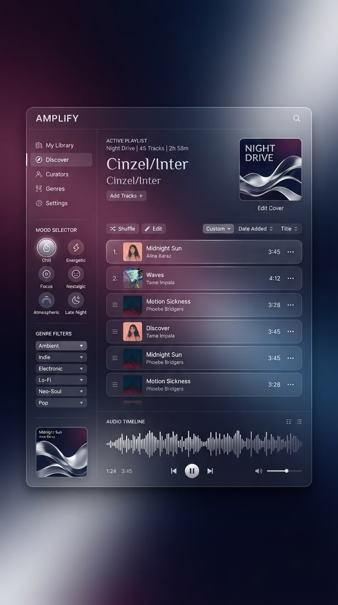
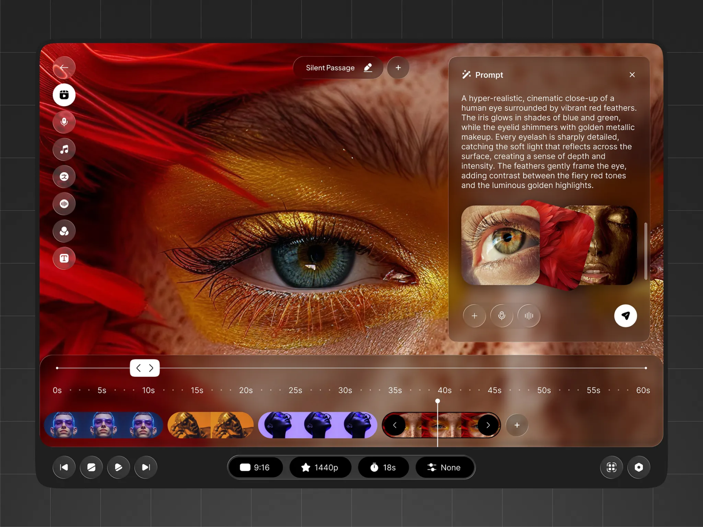
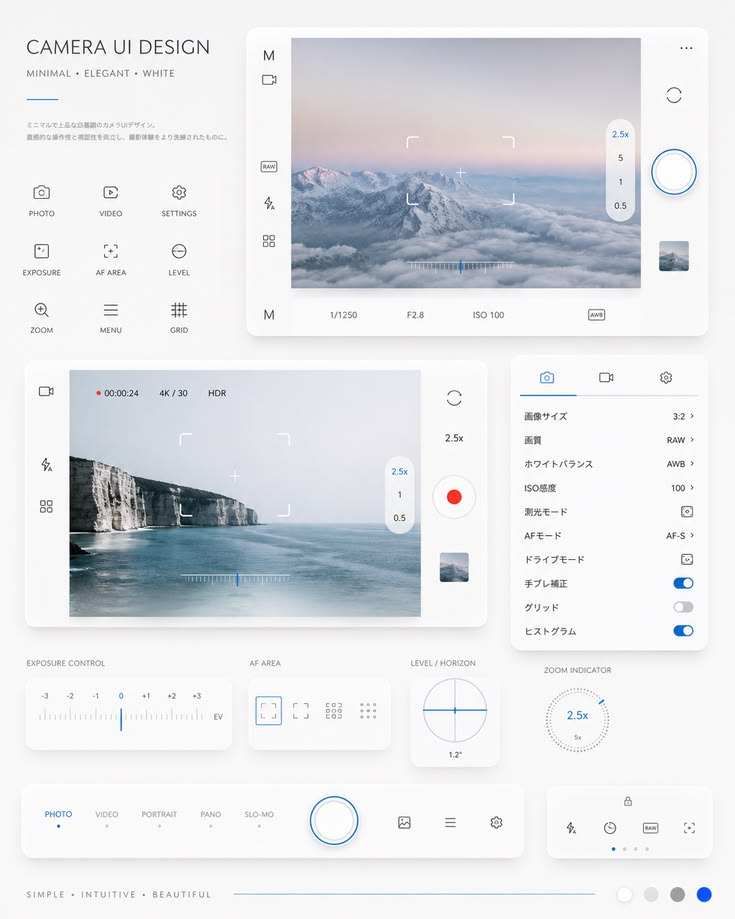
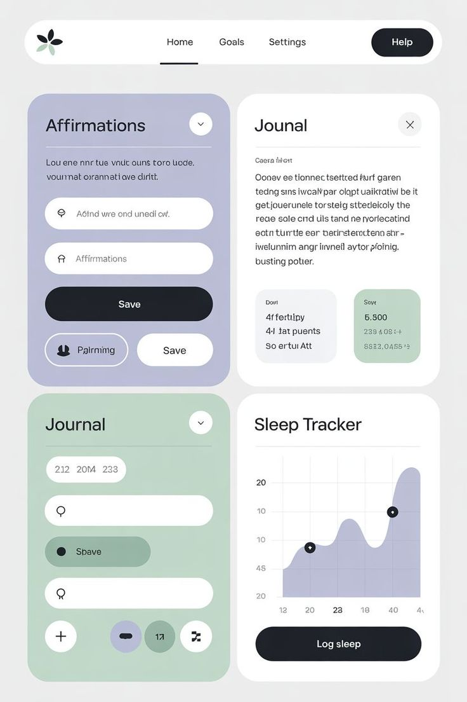

# 視覺風格參考庫

本庫只記錄風格本身（名稱、圖片、tokens、常見失敗），不放任何專案資訊。它們是可選參考，不是品牌規範。

詞彙來源：下表是已整理好 guide 的風格；其他公認風格名稱查 [ui-ux-pro-max-styles.csv](ui-ux-pro-max-styles.csv)（含 Keywords、Best For、Do Not Use For；授權見 [THIRD-PARTY-NOTICES.md](THIRD-PARTY-NOTICES.md)）。挑 `Type` 為 General、Mobile 或 Platform/* 的列（Landing Page、BI/Analytics 是版面模式，不是視覺風格）；`Status` 為 deprecated 的改用其 `Replacement ID`。新風格依 [../style-guide.md](../style-guide.md) 的 1–3、5 節整理後加進下表。

## 使用方式

1. 先依當前 brief 選風格，再開啟對應圖片及 guide；不要只讀風格名字就套通用版型。
2. guide 分開列「圖片觀察」與「建議 tokens」。字體名稱、色碼、blur、間距等數值是實作起點，不是原始設計檔量測值。
3. 借用構圖、材質、字體階層和控制元件語言；內容用當前專案自己的。圖片裡的文字不是產品需求，圖片也不能證明互動、動畫、響應式或可用性。
4. 使用者新的圖片與明確指示優先於本庫。只把選定風格的 guide 與圖片交給該版設計者。
5. 多方向提案怎樣才算不同，見 [../style-guide.md](../style-guide.md) 的並排比較表。

## 風格索引

| 風格／常見搜尋詞 | 對應原圖 | 結構核心 | Guide |
|---|---|---|---|
| Dark glassmorphism／dark glass／深色玻璃擬態 | AMPLIFY 音樂播放器、滿版影像剪輯器 | 影像或背景光穿透玻璃，工具與內容浮層重疊 | [深色玻璃](dark-glassmorphism.md) |
| Light minimalist with line icons／light simplicity／Minimalism & Swiss Style／Minimalist Monochrome／白色極簡／線條圖示／camera UI | 白色手機照片編輯器、白色相機 UI | 留白、開放畫布、細線控制，降低容器存在感 | [淺色極簡](light-minimalist-line-icons.md) |
| Material Design／Material 3 Expressive（CSV）／pastel material／柔和色塊／大圓角模組 | 日誌睡眠 dashboard、教育 dashboard | 不透明淡色模組、較大圓角、深色膠囊操作 | [Material 方向](material-design.md) |

「Material Design」保留使用者對這組圖的稱呼；視覺上是柔和色塊模組方向，不以圖片宣稱通過任何官方版本的規範檢查。

## 原圖預覽

### Dark glassmorphism

[音樂播放器原圖](images/dark-glass-audio.png) · [影像剪輯器原圖](images/dark-glass-video.png)

### Light minimalist with line icons

[手機照片編輯器原圖](images/light-photo-editor.png) · [相機 UI 原圖](images/light-camera.png)

### Material Design

[日誌睡眠原圖](images/material-wellness.png) · [教育 dashboard 原圖](images/material-learning.png)

## 來源

全部為使用者上傳的原始 PNG，未重繪、未裁切、未壓縮。原作者及原始網址未提供，不自行猜測；不把參考圖直接當作可再發布的產品素材。檔案尺寸、訊息時間與 SHA-256 見 [manifest.json](manifest.json)。
